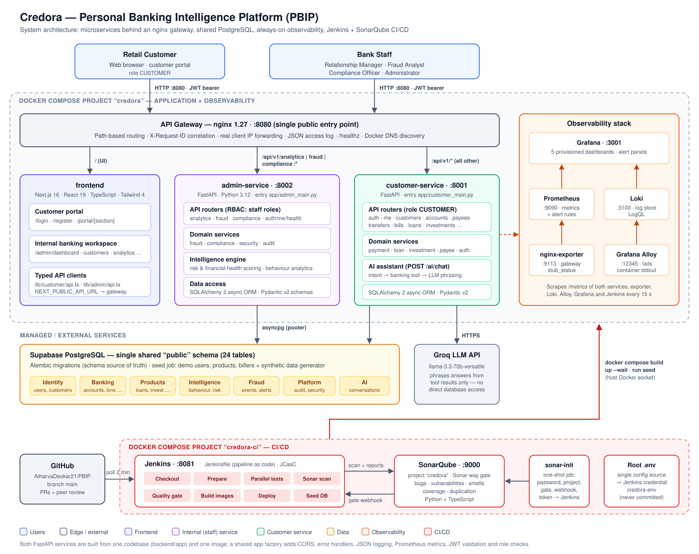
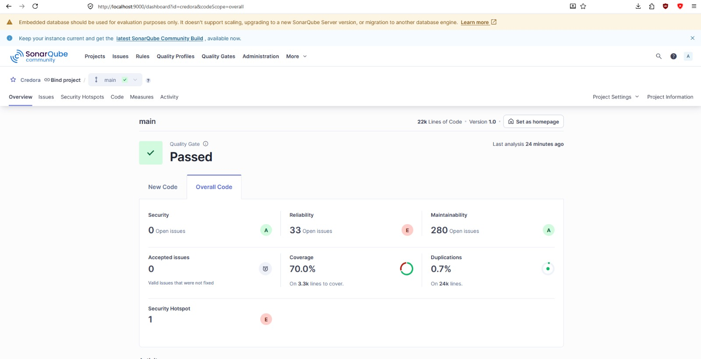
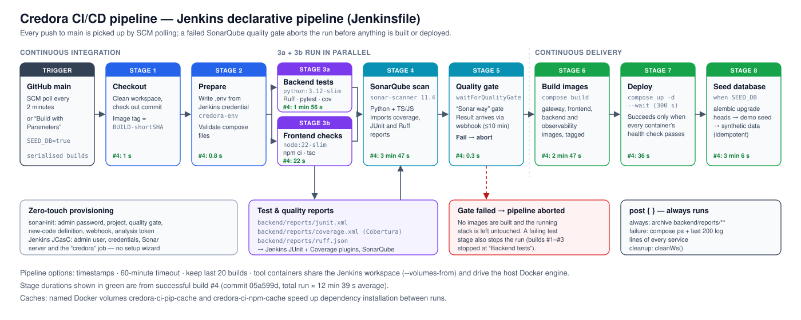
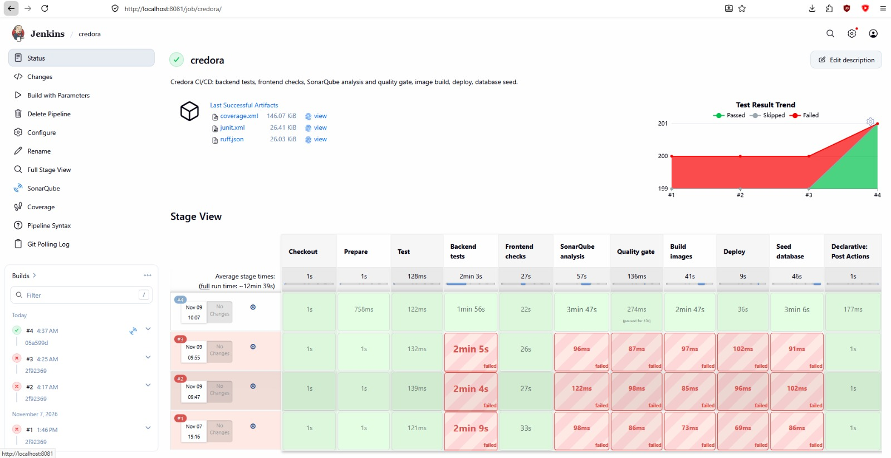
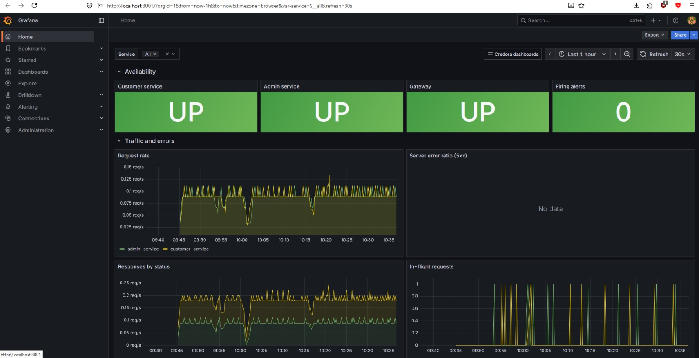
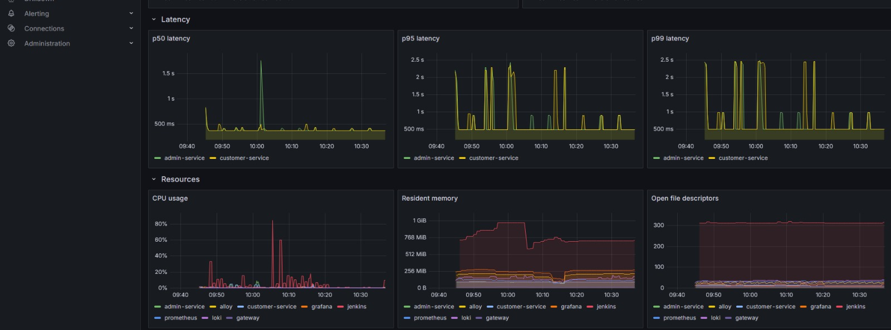

# Credora — Personal Banking Intelligence Platform (PBIP)

## Project Documentation

| | |
|---|---|
| **Document** | Comprehensive project documentation: architecture, technology, requirements, quality metrics, CI/CD |
| **System** | Credora — Personal Banking Intelligence Platform (PBIP) |
| **Project type** | Industry-aligned final-year software engineering capstone (BFSI domain) |
| **Repository** | `https://github.com/AtharvaDeokar21/PBIP` — branch `main` |
| **Baseline commit** | `05a599d` — *Fix: AI chat recommendations crash, dev reload crash; build main in Jenkins* (Jenkins build #4) |
| **Status** | Implemented and deployed through the CI/CD pipeline |
| **Date** | 9 November 2026 |

---

## Table of contents

1. [Executive summary](#1-executive-summary)
2. [Project overview](#2-project-overview)
3. [Architecture](#3-architecture)
4. [Tools and technologies](#4-tools-and-technologies)
5. [Functional requirements](#5-functional-requirements)
6. [Non-functional requirements](#6-non-functional-requirements)
7. [Testing strategy and code coverage metrics](#7-testing-strategy-and-code-coverage-metrics)
8. [CI/CD pipeline](#8-cicd-pipeline)
9. [Observability and monitoring](#9-observability-and-monitoring)
10. [Deployment and operations](#10-deployment-and-operations)
11. [Repository structure](#11-repository-structure)
12. [Known limitations and future work](#12-known-limitations-and-future-work)
13. [Appendix A — API catalogue](#appendix-a--api-catalogue)
14. [Appendix B — Glossary](#appendix-b--glossary)

---

## 1. Executive summary

**Credora** is a full-stack digital banking platform that combines everyday retail-banking services (accounts, transfers, bill payments, payees, loans, investments, insurance) with an **intelligence layer**: behavioural analytics, customer risk and financial-health scoring, fraud detection and investigation, compliance monitoring, product recommendations and a conversational **AI banking assistant**.

The platform serves two audiences through one web application:

- **Retail customers** use the *customer portal* to manage their money, explore products and ask the AI assistant questions about their finances.
- **Bank staff** (relationship managers, fraud analysts, compliance officers, administrators) use the *internal banking workspace* to analyse customer behaviour, investigate fraud alerts and review audit and security events.

Engineering highlights:

| Area | Outcome |
|---|---|
| Architecture | Microservices behind an nginx API gateway: Next.js frontend, FastAPI **customer-service** and **admin-service**, shared Supabase PostgreSQL |
| Security | bcrypt password hashing, JWT (HS256) authentication, role-based access control on every endpoint, ownership checks, audit log and security-event trail |
| Quality | **201 automated backend tests** (all passing), **14 Playwright end-to-end journeys**, **76.8 % line coverage** (SonarQube overall coverage **70.0 %**), SonarQube quality gate **Passed** with **0 security issues** and **0.7 % duplication** |
| CI/CD | Jenkins pipeline-as-code with 8 stages — test, static analysis, blocking quality gate, image build, health-checked deploy and database seed — fully provisioned from one `.env` file |
| Observability | Prometheus metrics, Loki + Grafana Alloy log aggregation, 5 provisioned Grafana dashboards, 4 alert rules, structured JSON logs with request correlation |

---

## 2. Project overview

### 2.1 Business context

Retail banking is moving from transaction-centric services to intelligent financial ecosystems. Banks need systems that understand customer behaviour, detect fraud and unusual activity, offer relevant products, reduce operational risk, support regulatory obligations and deliver a seamless digital experience. Credora is a simplified but realistic implementation of these capabilities.

### 2.2 Vision

To deliver a secure, scalable and intelligent personal banking platform that combines traditional banking functionality with analytics, AI-driven recommendations, behavioural insights and fraud monitoring — built with the engineering discipline expected of a production BFSI system.

### 2.3 Objectives

| Business objectives | Technical objectives |
|---|---|
| Digital management of bank accounts | Full-stack application development |
| Secure money transfers and bill payments | API-first architecture with versioned REST endpoints |
| Investment and lending product exploration | Secure software design (authentication, RBAC, auditing) |
| Personalised product recommendations | Relational data modelling with versioned migrations |
| Intelligent financial insights | Analytics, reporting and AI integration |
| Fraud and suspicious-activity detection | CI/CD, automated testing and static analysis |
| Customer engagement through an AI assistant | Observability and operational readiness |

### 2.4 Actors and roles

| Actor | System role | Primary capabilities |
|---|---|---|
| Retail Customer | `CUSTOMER` | Dashboard, accounts, statements, transfers, bills, payees, loans, investments, insurance, recommendations, AI assistant |
| Relationship Manager | `RELATIONSHIP_MANAGER` | Dashboard overview, customer directory, behavioural analytics, transaction analytics |
| Fraud Analyst | `FRAUD_ANALYST` | Fraud investigations and alerts, customer risk, security events |
| Compliance Officer | `COMPLIANCE_OFFICER` | Compliance alerts, audit logs, security events |
| Banking Administrator | `ADMIN` | All internal capabilities |
| AI Assistant | — (system component) | Answers customer questions using the customer's own data, through backend tools |

### 2.5 Scope

**Customer portal** — dashboard, account services, payments and transfers, payees, scheduled payments, statements, loans, wealth (investments and insurance), analytics, recommendations, notifications, settings, AI assistant.

**Internal banking portal** — executive dashboard, customer directory and customer 360° detail, behavioural analytics, fraud monitoring and investigations, compliance and risk, audit logs, security events.

---

## 3. Architecture

### 3.1 System architecture diagram



*Figure 1 — Credora system architecture (source: [`docs/images/architecture.svg`](images/architecture.svg)).*

### 3.2 Architectural style

Credora uses a **microservices architecture behind an API gateway**, deployed as Docker containers with Docker Compose:

| Principle | How it is applied |
|---|---|
| Single entry point | All browser traffic enters through the nginx gateway on port `8080`; services are not addressed directly by the UI. |
| Split by responsibility | **customer-service** serves the authenticated customer's own resources; **admin-service** serves cross-customer staff workloads (analytics, fraud, compliance). |
| Shared codebase, separate deployables | Both services are built from `backend/app` and one Docker image, with separate entry points (`customer_main.py`, `admin_main.py`) that mount only their own routers. |
| Stateless services | Authentication is a self-contained JWT; no server-side session state, so service containers can be scaled horizontally. |
| Shared database | One PostgreSQL `public` schema keeps foreign keys, joins and multi-table transactions intact (for example, a transfer updates accounts, ledger, audit log, notifications and security events atomically). |
| Layered services | Inside each service: **API router → domain service → ORM model**, with Pydantic schemas at the boundary. |
| AI behind the API | The LLM never touches the database: the backend runs a banking "tool" against the customer's own data and only the tool result is passed to the model for phrasing. |

### 3.3 Components

| Component | Technology | Responsibility | Port |
|---|---|---|---|
| `gateway` | nginx 1.27 | Path-based routing, `X-Request-ID` generation/propagation, real client IP forwarding, JSON access log, `/healthz`, Docker DNS service discovery, 5 s connect / 120 s read timeouts | `8080` (public) |
| `frontend` | Next.js 16, React 19, TypeScript, Tailwind CSS 4 | Landing page, customer portal (`/login`, `/register`, `/portal/*`), internal workspace (`/admin/*`) | `3000` (internal) |
| `customer-service` | FastAPI, Python 3.12 | Authentication, profile, accounts, transactions, payees, transfers, bills, loans, investments, insurance, recommendations, AI assistant | `8001` |
| `admin-service` | FastAPI, Python 3.12 | Dashboard overview, customer directory, behavioural analytics, fraud investigations and alerts, compliance alerts, audit logs, security events | `8002` |
| Supabase PostgreSQL | PostgreSQL (managed) | System of record — 24 tables in seven domain groups | — |
| Groq LLM API | `llama-3.3-70b-versatile` | Natural-language phrasing of AI assistant answers | — (HTTPS) |
| Observability | Prometheus, Loki, Grafana Alloy, Grafana, nginx-exporter | Metrics, logs, dashboards, alerting | `9090`, `3100`, `12345`, `3001` |
| CI/CD | Jenkins, SonarQube, sonar-init | Build, test, analyse, gate, build images, deploy, seed | `8081`, `9000` |

### 3.4 Gateway routing

| Order | Path match | Upstream |
|---|---|---|
| 1 | `= /healthz` | Gateway liveness (returns `ok`) |
| 2 | `~ ^/api/v1/(analytics\|fraud\|compliance)(/\|$)` | admin-service `:8000` |
| 3 | `/api/` | customer-service `:8000` |
| 4 | `/` | frontend `:3000` |

Both portals sign in through the same endpoint, `POST /api/v1/auth/login`. An automated test (`tests/test_service_split.py`) verifies that the two services together expose the complete API and that the gateway routes every endpoint to the service that actually serves it.

### 3.5 Backend layered design

```
backend/app/
├── customer_main.py / admin_main.py   # service entry points (mount routers)
├── core/            # app factory (CORS, error handlers, logging, metrics), config,
│                    # database session, security (bcrypt, JWT), dependencies (RBAC)
├── api/             # HTTP layer — FastAPI routers, request validation, auth dependencies
├── schemas/         # Pydantic v2 request/response contracts
├── services/        # business rules — payments, loans, investments, fraud, compliance, audit …
├── intelligence/    # analytics engine — risk & financial-health scoring, behaviour analytics
└── models/          # SQLAlchemy 2 async ORM models (24 tables)
```

| Layer | Responsibility | Design principle |
|---|---|---|
| API (`api/`) | Routing, input validation, authentication and role dependencies, HTTP status mapping | Thin controllers; no business logic |
| Schemas (`schemas/`) | Typed request/response contracts | Contracts are shared and reviewed by domain owners |
| Services (`services/`) | Business rules, transaction boundaries, audit and notification side effects | Single responsibility per domain |
| Intelligence (`intelligence/`) | Scoring and analytics over transactional and behavioural data | Pure calculation functions, unit-tested in isolation |
| Models (`models/`) | Persistence mapping with UUID primary keys and timestamp mixins | Schema evolves only through Alembic migrations |
| Core (`core/`) | Cross-cutting concerns: configuration, security, logging, metrics, error handling | Shared app factory gives both services identical behaviour |

### 3.6 Data architecture

| Domain group | Tables |
|---|---|
| Identity | `users`, `customers` |
| Banking | `accounts`, `transactions`, `payees`, `transfers`, `billers`, `bill_payments` |
| Products | `loan_products`, `loan_applications`, `investment_products`, `customer_investments`, `insurance_products` |
| Intelligence | `behaviour_events`, `customer_risk_profiles`, `recommendations` |
| Fraud | `fraud_events`, `fraud_alerts`, `fraud_investigations` |
| Platform | `notifications`, `audit_logs`, `security_events` |
| AI | `ai_conversations`, `ai_messages` |

- **Access:** SQLAlchemy 2 async ORM over `asyncpg`, connected through the Supabase transaction pooler.
- **Schema management:** 8 Alembic migrations are the source of truth (initial schema, payee activation flag, behaviour analytics fields, dashboard / directory / analytics-filter / financial-insight indexes, overall risk score). Tables are never created by hand.
- **Transactions:** each operation runs in one local database transaction inside the service that handles it — no distributed transactions are needed.
- **Data generation:** the `seed` job creates demo users for every role, products and billers (`scripts/seed.py`) and then synthetic customers, accounts, transactions, behaviour events, fraud scenarios and risk profiles (`data/generators/`). Both steps are idempotent.

### 3.7 Security architecture

| Concern | Implementation |
|---|---|
| Credential storage | bcrypt password hashes (`passlib`); passwords never logged or returned |
| Authentication | `POST /auth/login` issues an HS256 JWT containing `sub` (user ID), `role` and `exp`; lifetime from `ACCESS_TOKEN_EXPIRE_MINUTES` |
| Token validation | Every request validates the bearer token and reloads the user from the database, rejecting inactive accounts |
| Authorisation | `require_roles(...)` per endpoint; customer endpoints resolve the customer from the token and never accept a client-supplied `customer_id` |
| Ownership | Resources owned by another customer return `404` (no information leak); missing/invalid token `401`; insufficient role `403` |
| Business limits | Per-transfer limit ₹5,00,000 and daily limit ₹10,00,000; insufficient-balance checks; large transfers recorded as security events |
| Audit trail | `audit_logs` (who did what, when, from which IP) and `security_events` (`LOGIN_SUCCESS`, `LOGIN_FAILED`, large transfers …) |
| Network | Gateway overwrites `X-Real-IP` / `X-Forwarded-For` (anti-spoofing); services run with `--proxy-headers` so audit records the real client IP |
| Secrets | All secrets in the root `.env` (git-ignored); Jenkins receives it as a file credential; a random per-process JWT secret is used if none is configured |
| Log hygiene | Never logged: request/response bodies, `Authorization` headers, tokens, passwords, query strings, full account numbers |
| Static analysis | SonarQube security rules and hotspot review on every build — **0 open security issues** |

### 3.8 Intelligence and AI design

**Risk and financial-health scoring** (`intelligence/analytics/risk.py`) — for each customer, monthly income, spending, debt and spending volatility are derived from transaction history:

```
financial_health = clamp(70 + savings_ratio × 35 − min(DTI, 2) × 20 − min(volatility, 2) × 10)
overall_risk     = clamp((100 − financial_health) × 0.42 + min(DTI, 1.5) × 12 + min(volatility, 2) × 5)
```

Scores feed loan eligibility, the customer directory, the dashboard and recommendations.

**Fraud scenarios** — the synthetic data generator injects five realistic fraud patterns, each producing fraud events and alerts that analysts investigate in the internal portal:

| Scenario | Pattern | Severity |
|---|---|---|
| 1 | Large single transaction | HIGH |
| 2 | Impossible travel (logins from distant locations) | CRITICAL |
| 3 | Brute-force login followed by a transfer | CRITICAL |
| 4 | High-velocity consecutive transactions | HIGH |
| 5 | Monthly spending spike | MEDIUM |

**AI banking assistant** (`POST /api/v1/ai/chat`):

1. The conversation and user message are stored (`ai_conversations`, `ai_messages`).
2. The intent is matched to a banking tool — `get_spending_summary`, `get_account_balance`, `get_recent_transactions`, `get_loan_products`, `get_recommendations`, `get_customer_investments`, `get_customer_profile`.
3. The tool runs against **the authenticated customer's own data only**.
4. If a Groq API key is configured, the tool output is sent to the LLM to be phrased naturally; otherwise a deterministic answer is returned (graceful degradation).
5. The answer and tool name are stored and returned.

### 3.9 Deployment view

| Compose project | File | Contents |
|---|---|---|
| `credora` | `docker-compose.yml` (includes `observability/compose.yml`) | Gateway, frontend, customer-service, admin-service, observability stack; one-shot `migrate` and `seed` jobs (profiles `setup`, `seed`) |
| `credora-ci` | `ci/docker-compose.yml` | Jenkins, SonarQube, sonar-init — independent of application redeploys |

Every application container has a Docker health check (`/api/v1/health` for the services, `/healthz` for the gateway, `/login` for the frontend). `docker-compose.ci.yml` is the override Jenkins uses: it removes source bind mounts and auto-reload so containers run purely from the built images.

---

## 4. Tools and technologies

### 4.1 Frontend

| Technology | Version | Purpose |
|---|---|---|
| Next.js (App Router) | 16.x | React framework, routing, server rendering, production build |
| React | 19.x | UI component model |
| TypeScript | 5.8 | Static typing; `tsc --noEmit` type check in CI |
| Tailwind CSS | 4.x | Utility-first styling and design system |
| lucide-react | 0.468 | Icon set |
| Playwright | 1.63 | End-to-end UI testing (desktop, tablet and mobile viewports) |
| Prettier | 3.x | Code formatting |

### 4.2 Backend

| Technology | Version | Purpose |
|---|---|---|
| Python | 3.12 | Service runtime |
| FastAPI | 0.116 | REST framework, OpenAPI / Swagger UI (`/docs`) |
| Uvicorn | 0.35 | ASGI server |
| Pydantic / pydantic-settings | 2.11 / 2.10 | Validation, schemas, typed configuration |
| SQLAlchemy (async) | 2.0 | ORM and query building |
| asyncpg | 0.30 | PostgreSQL async driver |
| Alembic | 1.16 | Database migrations |
| python-jose | 3.5 | JWT encoding and validation |
| passlib + bcrypt | 1.7 / 4.0 | Password hashing |
| httpx | 0.28 | Async HTTP client (Groq API, tests) |
| prometheus-fastapi-instrumentator | 7.1 | `/metrics` endpoint (request counts, latency histograms) |
| Faker | 37.8 | Synthetic data generation |
| pytest, pytest-asyncio, pytest-cov, aiosqlite | 8.4, 1.1, 6.2, 0.22 | Test framework, async tests, coverage, in-memory test DB |
| Ruff | 0.12 | Linting (report imported into SonarQube) |

### 4.3 Data and AI

| Technology | Purpose |
|---|---|
| Supabase PostgreSQL | Managed relational database |
| Groq API — `llama-3.3-70b-versatile` | LLM for the AI assistant's natural-language responses |

### 4.4 DevOps, CI/CD and quality

| Technology | Version | Purpose |
|---|---|---|
| Git + GitHub | — | Source control, feature branches, pull requests, peer review |
| Docker / Docker Compose | Compose v2 | Containerisation and orchestration of all stacks |
| nginx | 1.27 | API gateway / reverse proxy |
| Jenkins | LTS (custom image) | Pipeline as code (`Jenkinsfile`), configuration as code (JCasC) |
| SonarQube Community | 25.8 | Static analysis, coverage, duplication, security hotspots, quality gate |
| sonar-scanner-cli | 11.4 | Analysis client run by the pipeline |

### 4.5 Observability

| Technology | Purpose |
|---|---|
| Prometheus | Metrics collection (15 s scrape) and alert rules |
| Grafana | Dashboards and alert visualisation (provisioned as code) |
| Loki | Log storage and LogQL querying |
| Grafana Alloy | Log collection from container stdout via the Docker API |
| nginx-prometheus-exporter | Gateway connection and request metrics |

---

## 5. Functional requirements

Status legend: ✅ Implemented · ◐ Partially implemented / simulated in the UI.

### 5.1 Identity and access

| ID | Requirement | Use case | Implementation | Status |
|---|---|---|---|---|
| FR-01 | Customers register an account with profile details | UC-01 | `POST /auth/register` creates `users` + `customers`, audit entry | ✅ |
| FR-02 | Customers and staff sign in with email and password | UC-01 | `POST /auth/login` → JWT; separate customer and admin login pages | ✅ |
| FR-03 | Failed and successful logins generate security events | UC-01, UC-13 | `LOGIN_FAILED` / `LOGIN_SUCCESS` in `security_events` | ✅ |
| FR-04 | Multi-factor authentication | UC-01 | OTP step shown in the transfer flow and settings (sample OTP; no SMS/e-mail provider) | ◐ |
| FR-05 | Each user can only access functions permitted by their role | — | `require_roles(...)` on every endpoint; 5 roles | ✅ |
| FR-06 | Session expiry is handled gracefully | — | `/session-expired` page, token lifetime from configuration | ✅ |

### 5.2 Customer banking

| ID | Requirement | Use case | Implementation | Status |
|---|---|---|---|---|
| FR-07 | Dashboard with balances, recent transactions, spending insights and recommendations | UC-02 | `GET /customers/me/summary`, `/accounts`, `/recommendations`; `/portal/dashboard` | ✅ |
| FR-08 | View account details and transaction history with search/filters | UC-02 | `GET /accounts`, `/accounts/{id}`, `/accounts/{id}/transactions`, `/transactions/{id}` | ✅ |
| FR-09 | View and download statements for a chosen period | UC-03 | `/portal/statements` with custom period validation; *Print / save as PDF* | ✅ |
| FR-10 | Manage payees — add, edit, deactivate/delete | UC-05 | `POST/GET/PATCH/DELETE /payees` with audit entries | ✅ |
| FR-11 | Transfer money with balance, limit and fraud checks | UC-04 | `POST /transfers` — per-transfer and daily limits, balance check, large-transfer security event, notification | ✅ |
| FR-12 | Schedule and cancel future transfers | UC-04 | `scheduled_at` on transfers; `POST /transfers/{id}/cancel`; `/portal/scheduled` | ✅ |
| FR-13 | Pay bills to registered billers and view history | — | `GET /billers`, `POST /bills/pay`, `GET /bills/history` | ✅ |
| FR-14 | Notifications for money movement and applications | UC-10 | `notifications` written by transfers, bills and loan applications | ✅ |
| FR-15 | Update profile and settings | — | `PATCH /customers/me`; `/portal/settings` | ✅ |

### 5.3 Products and wealth

| ID | Requirement | Use case | Implementation | Status |
|---|---|---|---|---|
| FR-16 | Browse the loan catalogue | UC-06 | `GET /loans/products`, `/loans/products/{id}` | ✅ |
| FR-17 | Check loan eligibility using income, spending and risk profile | UC-06 | `POST /loans/eligibility` using `customer_risk_profiles` | ✅ |
| FR-18 | EMI calculator and product comparison | UC-06 | Portal EMI calculator (handles zero interest), comparison of up to 3 products | ✅ |
| FR-19 | Apply for a loan and track applications | UC-06 | `POST/GET /loans/applications` | ✅ |
| FR-20 | Browse and invest in investment products (FDs, mutual funds, bonds …) | UC-07 | `GET /investments/products`, `POST /investments`, `GET /investments` | ✅ |
| FR-21 | Browse insurance products | UC-07 | `GET /insurance/products` | ✅ |
| FR-22 | Personalised product recommendations from behaviour and profile | UC-06, UC-07, UC-12 | `GET /recommendations` (generated from behaviour, risk and product data) | ✅ |

### 5.4 AI banking assistant

| ID | Requirement | Use case | Implementation | Status |
|---|---|---|---|---|
| FR-23 | Answer natural-language questions about spending, balances, transactions, loans, investments and recommendations | UC-08 | `POST /ai/chat` — intent → banking tool → Groq LLM phrasing | ✅ |
| FR-24 | Keep conversation history | UC-08 | `GET /ai/conversations`, `/ai/conversations/{id}` | ✅ |
| FR-25 | Work without the LLM provider | UC-08 | Deterministic tool-based answers when no API key is configured or the call fails | ✅ |

### 5.5 Internal banking portal

| ID | Requirement | Use case | Implementation | Status |
|---|---|---|---|---|
| FR-26 | Executive dashboard: customers, balances, transaction volume, risk, fraud | UC-13 | `GET /analytics/overview`; `/admin/dashboard` | ✅ |
| FR-27 | Customer directory with filtering, sorting, pagination and customer 360° view | UC-11 | `GET /analytics/customers`; `/admin/customers`, `/admin/customers/[id]` | ✅ |
| FR-28 | Behavioural analytics: segmentation, spending patterns, product affinity, engagement | UC-11 | `GET /analytics/behaviour`, `/analytics/behaviour/filters`; `/admin/analytics` | ✅ |
| FR-29 | Fraud risk scoring for customers and events | UC-09 | Risk profiles + fraud events with risk scores; `GET /fraud/customers/{id}/risk` | ✅ |
| FR-30 | Fraud alert and investigation management (review, assign, resolve) | UC-10 | `GET /fraud/investigations`, `/fraud/alerts`, `PATCH /fraud/alerts/{id}` | ✅ |
| FR-31 | Compliance alerts and exception monitoring | — | `GET /compliance/alerts`; `/admin/compliance` | ✅ |
| FR-32 | Audit history with filters | — | `GET /compliance/audit-logs`; `/admin/audit-logs` | ✅ |
| FR-33 | Security monitoring: login anomalies, high-risk events | UC-13 | `GET /compliance/security-events`; `/admin/fraud` | ✅ |

---

## 6. Non-functional requirements

| ID | Category | Requirement / target | How it is met | Evidence |
|---|---|---|---|---|
| NFR-01 | Security | Secure authentication | bcrypt hashing, signed JWT with expiry, token re-validation against the database | `tests/test_security.py`, auth tests |
| NFR-02 | Security | Role-based access control | `require_roles` on every endpoint; ownership checks return 404 | 401/403/404 tests across API suites |
| NFR-03 | Security | Audit logging | `audit_logs` and `security_events` written by all state-changing operations | `test_audit_logs.py` (17 tests), `test_security_events.py` (14 tests) |
| NFR-04 | Security | OWASP Top 10 protection | Parameterised ORM queries (injection), Pydantic validation, RBAC (broken access control), no secrets in code, anti-spoofing headers, log redaction, SonarQube security rules | SonarQube **Security: A, 0 open issues** |
| NFR-05 | Security | Sensitive data protection | Secrets only in `.env`; no tokens, passwords or full account numbers in logs; HTTPS to the Groq API | `core/logging.py`, README logging policy |
| NFR-06 | Performance | API response time < 500 ms | Async I/O end to end, connection pooling, 5 dedicated index migrations for dashboard, directory and analytics queries | Grafana p50 latency mostly below 500 ms (Figure 6); p95 spikes discussed in §12 |
| NFR-07 | Performance | Page load < 2 s, login < 3 s | Next.js production build, route-level rendering, single gateway hop | Playwright journeys run against the production build |
| NFR-08 | Availability | ≥ 99 % availability in the test environment | Health checks on every container, `restart: unless-stopped`, deploy waits for healthy state, `ServiceDown` alert | Grafana availability panels: customer, admin and gateway **UP**, 0 firing alerts (Figure 5) |
| NFR-09 | Scalability | Horizontal scaling, stateless APIs, containerised deployment | JWT (no server session), Docker DNS discovery in the gateway, independent service containers | `docker-compose.yml`, `gateway/nginx.conf` |
| NFR-10 | Observability | Centralised logging, error tracking, health and performance metrics | JSON logs → Alloy → Loki; Prometheus metrics; 5 Grafana dashboards; 4 alert rules; `X-Request-ID` tracing | §9 |
| NFR-11 | Maintainability | Layered architecture, SOLID, clean code | Router → service → model layering, shared app factory, typed schemas; Ruff lint; SonarQube **Maintainability: A** | SonarQube overview (Figure 2) |
| NFR-12 | Maintainability | Low duplication | Shared factory and helpers | SonarQube **duplication 0.7 %** on 24k lines |
| NFR-13 | Testability | ≥ 70 % automated test coverage | 201 backend tests on in-memory SQLite, coverage enforced through the quality gate | **76.8 % line coverage**, SonarQube **70.0 %** (§7) |
| NFR-14 | Reliability | Consistent money movement | One database transaction per operation; balance and limit checks before ledger writes | Transfer, bill and investment tests |
| NFR-15 | Usability | Responsive UI on desktop, tablet and mobile | Responsive layouts, table overflow handling, narrow-viewport checks | Playwright viewport tests |
| NFR-16 | Portability / deployability | Repeatable automated deployment | Entire platform, observability and CI stacks start with one `docker compose up`; zero-touch CI provisioning | §8, §10 |
| NFR-17 | Data integrity | Versioned schema | 8 Alembic migrations, no manual table changes | `backend/alembic/versions/` |

---

## 7. Testing strategy and code coverage metrics

### 7.1 Test levels

| Level | Tooling | Scope | Count |
|---|---|---|---|
| Unit | pytest | Intelligence calculations (financial insights, risk profiles), security helpers | 8 tests |
| API / integration | pytest, pytest-asyncio, httpx `AsyncClient`, aiosqlite | Every customer and admin endpoint through the full FastAPI stack against an in-memory database: success paths, validation, 401/403/404, ownership, limits, pagination, filters | 190 tests |
| Architecture | pytest | `test_service_split.py` — both services together expose the full API; gateway routes every endpoint to the right service | 3 tests |
| End-to-end UI | Playwright | 14 critical user journeys plus per-section narrow-viewport checks, desktop/tablet/mobile | 14 journeys + per-section viewport checks |
| Static analysis | SonarQube, Ruff, TypeScript compiler | Bugs, vulnerabilities, code smells, hotspots, duplication, type errors | Every build |

**Test isolation:** backend tests run against in-memory SQLite (or an explicit `TEST_DATABASE_URL`). The test suite refuses to run against Supabase, so CI never touches the shared database during testing.

### 7.2 Test inventory

| Suite | Tests | Suite | Tests |
|---|---|---|---|
| `api/test_fraud_investigations.py` | 38 | `test_investments_api.py` | 5 |
| `api/test_audit_logs.py` | 17 | `test_loans_api.py` | 4 |
| `api/test_compliance_alerts.py` | 17 | `test_payees_api.py` | 4 |
| `api/test_security_events.py` | 14 | `test_transfers_api.py` | 4 |
| `api/test_analytics_behaviour.py` | 7 | `test_bills_api.py`, `test_customers_api.py`, `test_transactions_api.py`, `test_service_split.py` | 3 each |
| `api/test_analytics_customers.py` | 5 | `intelligence/test_financial.py`, `intelligence/test_risk_profiles.py` | 3 each |
| `api/test_analytics_overview.py` | 4 | `test_accounts_api.py`, `test_insurance_api.py`, `test_security.py` | 2 each |
| | | `test_ai_api.py`, `test_health.py`, `test_recommendations_api.py` | 1 each |

146 test functions expand to **201 test cases** through parametrisation. **Result: 201 passed, 0 failed** (local run on 9 Nov 2026, and Jenkins build #4).

**Playwright journeys** (`frontend/tests/`): internal dashboard navigation without client errors; customer directory filters, pagination, sorting and detail round-trip; analytics combined filters; admin sign-in and missing-customer handling; tablet/mobile admin layouts; landing and customer dashboard responsiveness; account filters and empty states; transfer validation (funds, paise precision, review, OTP); bill shortcut; payee preview/edit/remove; statement custom period; EMI zero-interest and 3-product comparison cap; AI assistant conversation; separation of customer login, sign-up and admin login.

### 7.3 Coverage summary

| Metric | Value | Source |
|---|---|---|
| Statements | **3,300** | coverage.py (`backend/app`) |
| Statements covered | **2,535** | |
| **Line coverage** | **76.8 %** | `coverage.xml` |
| Branches | 604 (225 covered) | |
| Branch coverage | 37.3 % | |
| Combined line + branch (coverage.py total) | **71 %** | `pytest --cov` terminal report |
| **SonarQube overall coverage** | **70.0 %** on 3.3k lines to cover | SonarQube project `credora` (Figure 2) |
| Target (use-case document) | ≥ 70 % | ✅ met |

SonarQube reports a slightly lower number than line coverage because it combines **line and condition (branch) coverage** into one figure. Coverage is measured for the backend application code (`backend/app`); scripts, tests and the frontend (which is covered by Playwright end-to-end tests instead of unit-test coverage) are excluded through `sonar.coverage.exclusions`.

### 7.4 Coverage by layer

| Package | Lines covered | Line coverage | Branch coverage |
|---|---|---|---|
| `models/` | 317 / 317 | **100.0 %** | — |
| `schemas/` | 543 / 556 | **97.7 %** | 56.7 % |
| entry points (`main`, `customer_main`, `admin_main`) | 40 / 40 | **100.0 %** | — |
| `core/` | 187 / 232 | **80.6 %** | 47.1 % |
| `api/` | 359 / 453 | **79.2 %** | 7.5 % |
| `intelligence/analytics/` | 425 / 645 | **65.9 %** | 30.4 % |
| `services/` | 664 / 1,057 | **62.8 %** | 40.6 % |
| **Total** | **2,535 / 3,300** | **76.8 %** | **37.3 %** |

### 7.5 Coverage by module (highlights)

| Fully covered (100 %) | Well covered (≥ 80 %) | Below target (< 60 %) |
|---|---|---|
| All 8 model modules | `intelligence/analytics/financial.py` 93 % | `api/ai.py` 29 % |
| 13 of 16 schema modules | `api/payees.py` 95 % | `intelligence/analytics/service.py` 32 % |
| `api/accounts.py`, `bills.py`, `compliance.py`, `customers.py`, `insurance.py`, `investments.py`, `loans.py`, `recommendations.py`, `router.py`, `transactions.py`, `transfers.py` | `api/fraud.py` 89 %, `api/me.py` 90 % | `services/transaction_service.py` 26 % |
| `core/config.py`, `core/exceptions.py` | `intelligence/analytics/risk.py` 87 % | `services/auth_service.py` 27 % |
| `customer_main.py`, `admin_main.py`, `main.py` | `core/logging.py` 88 %, `core/database.py` 92 % | `services/security_service.py` 47 %, `payment_service.py` 48 % |
| | `services/account_service.py` 91 % | `core/app_factory.py` 54 %, `services/investment_service.py` 51 % |

**Improvement plan.** The largest uncovered areas are the AI assistant's per-intent branches (the Groq call path is not exercised in tests), the behaviour-analytics aggregation service, and failure branches of the payment, auth and security services. Planned additions: mocked Groq responses for each tool intent, parametrised analytics-filter tests, and negative-path tests for transfer limits and login lock-out. These would raise branch coverage, which is currently the weakest metric.

### 7.6 SonarQube quality metrics



*Figure 2 — SonarQube project `credora`, branch `main`, overall code.*

| Metric | Result | Rating |
|---|---|---|
| Quality gate (*Sonar way*) | **Passed** | ✅ |
| Lines of code | ~22k (24k lines incl. comments/blank) | — |
| Security — open issues | **0** | **A** |
| Reliability — open issues | 33 | E (at least one blocker-severity bug open; see §12) |
| Maintainability — open issues (code smells) | 280 | **A** |
| Coverage | **70.0 %** (3.3k lines to cover) | — |
| Duplications | **0.7 %** on 24k lines | ✅ |
| Security hotspots | 1 to review | E until reviewed |
| Accepted issues | 0 | — |

The *Sonar way* gate evaluates **new code**: no new issues, all new security hotspots reviewed, ≥ 80 % coverage and ≤ 3 % duplication on new code. The first analysis established the baseline; each later commit must keep new code clean, which is why the gate passes while legacy findings on overall code are worked down.

---

## 8. CI/CD pipeline

### 8.1 Overview

Credora's CI/CD is implemented with **Jenkins** (pipeline as code in the root `Jenkinsfile`) and **SonarQube** (static analysis and quality gate), running in their own Docker Compose project (`ci/docker-compose.yml`). The pipeline builds the `main` branch of the GitHub repository and delivers the result to the same Docker engine that hosts the application.



*Figure 3 — Pipeline stages, parallel test lanes, quality gate and post actions (source: [`docs/images/cicd-pipeline.svg`](images/cicd-pipeline.svg)).*

The pipeline maps to the DevOps requirements of the use-case document as follows:

| Required step | Pipeline stage |
|---|---|
| Build | Checkout, Prepare, Build images |
| Test | Backend tests, Frontend checks (parallel) |
| Code quality scan | SonarQube analysis, Quality gate |
| Security scan | SonarQube security rules and hotspots (part of the gate) |
| Package | Build images (tagged `<build>-<commit>`) |
| Deploy | Deploy (`docker compose up --wait`) |
| Smoke test | Container health checks gate the Deploy stage; Seed exercises migrations and the database end to end |

### 8.2 Trigger

- **SCM polling every 2 minutes** — every push to `main` triggers a build automatically; the first build starts shortly after Jenkins comes up.
- **Build with Parameters** — manual runs; parameter `SEED_DB` (default `true`) controls the seeding stage.
- Options: `disableConcurrentBuilds`, `timestamps`, 60-minute timeout, keep last 20 builds.

### 8.3 Stage-by-stage explanation

| # | Stage | What happens | Tooling | Fails when |
|---|---|---|---|---|
| 1 | **Checkout** | Cleans the workspace, checks out the commit, computes `IMAGE_TAG = <build number>-<short SHA>` and labels the build with the SHA | Jenkins Git | Repository unreachable |
| 2 | **Prepare** | Writes `.env` from the Jenkins file credential `credora-env` (mode 600), prints Docker/Compose versions, validates both compose files with `docker compose config --quiet` | Docker CLI | Invalid compose configuration |
| 3a | **Backend tests** *(parallel)* | In `python:3.12-slim`: installs dependencies, runs Ruff → `ruff.json`, runs pytest with `--junitxml` and `--cov` → `junit.xml`, `coverage.xml`; rewrites test class names so SonarQube can map them. Results published to Jenkins JUnit and Coverage plugins | pytest, coverage.py, Ruff | Any test fails |
| 3b | **Frontend checks** *(parallel)* | In `node:22-bookworm-slim`: `npm ci` and `tsc --noEmit` | npm, TypeScript | Type error or dependency failure |
| 4 | **SonarQube analysis** | Runs `sonar-scanner` on the `credora-ci` network over `backend/app`, `backend/scripts` and `frontend/src`, importing coverage, test and Ruff reports; tags the analysis with the image tag | sonar-scanner-cli 11.4 | Scanner/analysis error |
| 5 | **Quality gate** | `waitForQualityGate abortPipeline: true` waits (≤ 10 min) for SonarQube's webhook with the gate result | SonarQube webhook | **Gate fails → pipeline aborted** |
| 6 | **Build images** | `docker compose build` of gateway, frontend, backend and the observability images, tagged with `IMAGE_TAG` | Docker Compose | Build error |
| 7 | **Deploy** | `docker compose up -d --remove-orphans --wait --wait-timeout 300` — succeeds only when **every container reports healthy**; then prints `compose ps` | Docker Compose health checks | Any container unhealthy within 300 s |
| 8 | **Seed database** | When `SEED_DB`: `alembic upgrade heads` → demo seed → synthetic data generator (idempotent) | Alembic, seed scripts | Migration or seed error |

**Post actions:** `always` archives `backend/reports/**` (JUnit, coverage, Ruff) as build artifacts; on `failure` prints `compose ps -a` and the last 200 log lines of every service for diagnosis; `cleanup` wipes the workspace.

**How tools run:** Jenkins drives the host Docker engine through the mounted socket. Build tools run in throw-away containers that share the Jenkins workspace (`--volumes-from`), so no host paths are involved and the Jenkins image stays small. Named volumes (`credora-ci-pip-cache`, `credora-ci-npm-cache`) cache dependencies between runs.

### 8.4 Zero-touch provisioning

Starting the CI stack (`docker compose -f ci/docker-compose.yml up -d --build`) requires no setup wizard and no manually copied tokens:

| Component | Provisioned automatically |
|---|---|
| **sonar-init** (one-shot) | Changes SonarQube's default admin password, creates project `credora`, assigns the *Sonar way* gate, sets the new-code definition, registers the Jenkins webhook (`http://jenkins:8080/sonarqube-webhook/`) and generates the analysis token into a shared volume |
| **Jenkins** (JCasC, `ci/jenkins/casc.yaml`) | Pre-installed plugins (`plugins.txt`), admin user, credentials (`credora-env` from the root `.env`, `sonar-token` from sonar-init), SonarQube server definition and the `credora` pipeline job |

Startup order is enforced by Compose: SonarQube healthy → sonar-init completed successfully → Jenkins starts.

### 8.5 Pipeline execution evidence



*Figure 4 — Jenkins job `credora`: stage view, test-result trend and archived artifacts.*

The screenshot shows the pipeline doing its job as a safety net:

| Build | Commit | Result | Explanation |
|---|---|---|---|
| #1 – #3 | `2f92369` | ❌ Failed at **Backend tests** | Failing tests stopped the pipeline; SonarQube, build, deploy and seed were skipped, so the broken commit never reached the running environment. |
| #4 | `05a599d` | ✅ **All stages passed** | After the fix (*AI chat recommendations crash, dev reload crash*), all **201 tests passed**, the quality gate passed and the stack was built, deployed healthy and seeded. |

Build #4 stage timings: Checkout 1 s · Prepare 0.8 s · Backend tests 1 min 56 s · Frontend checks 22 s (parallel) · SonarQube analysis 3 min 47 s · Quality gate 0.3 s · Build images 2 min 47 s · Deploy 36 s · Seed database 3 min 6 s. Average full run ≈ **12 min 39 s**.

Archived artifacts per build: `coverage.xml` (146 KiB), `junit.xml` (26 KiB), `ruff.json` (26 KiB). The **Test Result Trend** chart shows the transition from failing builds to 201 passing tests, and the job page links directly to SonarQube and the Coverage report.

### 8.6 Pipeline monitoring

Prometheus scrapes Jenkins' metrics endpoint; the alert `JenkinsBuildFailed` fires when the last `credora` build did not succeed, and the Grafana *Platform health* dashboard shows the current build status next to service health.

---

## 9. Observability and monitoring

### 9.1 Signals

| Signal | Collected by | Where to look |
|---|---|---|
| Metrics | Prometheus scrapes `/metrics` of both services, the nginx exporter, Loki, Alloy, Grafana and Jenkins every 15 s | Grafana dashboards, Prometheus `:9090` |
| Logs | Grafana Alloy reads every Credora container's stdout through the Docker API and ships it to Loki | Grafana → *Credora · Logs*, or *Explore* (Loki) |
| Alerts | Prometheus rules (below) | Prometheus `/alerts`, Grafana *Firing alerts* panels |
| Traces (correlation) | `X-Request-ID` assigned at the gateway and carried by every log line of a request | Logs dashboard request tracing |

### 9.2 Dashboards (provisioned as code)

| Dashboard | Shows |
|---|---|
| **Services overview** (home) | Up/down, request rate, 5xx ratio, p50/p95/p99 latency, in-flight requests, CPU, memory, file descriptors |
| **API endpoints** | Busiest, slowest and failing routes; per-route rate, latency and status codes |
| **API gateway** | Connections, requests/s, status codes, upstream latency, access log |
| **Logs** | Logs by service and level, text search, volume and errors, request tracing by `X-Request-ID` |
| **Platform health** | Scrape targets, alerts, Loki ingestion, Jenkins build status |



*Figure 5 — Services overview: customer-service, admin-service and gateway UP, 0 firing alerts, request rate, responses by status (no 5xx errors in the window) and in-flight requests.*



*Figure 6 — Latency percentiles (p50/p95/p99) per service and resource usage (CPU, resident memory, open file descriptors) per container.*

### 9.3 Alert rules

| Alert | Condition | Severity |
|---|---|---|
| `ServiceDown` | customer-service, admin-service or gateway not scrapeable for 1 min | critical |
| `HighErrorRate` | 5xx ratio > 5 % over 5 min | warning |
| `HighLatency` | p95 latency > 1 s for 5 min | warning |
| `JenkinsBuildFailed` | Last `credora` build did not succeed | warning |

### 9.4 Structured logging

Both services write one JSON object per line:

```json
{"ts":"2026-10-31T13:32:08.650Z","level":"INFO","service":"customer-service","logger":"credora.access","message":"request completed","request_id":"verify-trace-001","method":"GET","path":"/api/v1/accounts","route":"/api/v1/accounts","status":401,"duration_ms":2.1,"client_ip":"172.20.0.1"}
```

Example LogQL queries:

```logql
{service="customer-service"} | json | status >= 500
{service=~"gateway|customer-service|admin-service"} |= "<request id>"
```

`LOG_LEVEL` controls verbosity; health-check and `/metrics` requests log at `DEBUG` to keep logs useful. Business audit trails remain in the `audit_logs` and `security_events` tables.

---

## 10. Deployment and operations

### 10.1 Prerequisites

Docker Desktop (≥ 8 GB memory when the CI stack also runs) and a repository-root `.env` created from `.env.example`.

| Key | Purpose |
|---|---|
| `DATABASE_URL` | Supabase PostgreSQL connection (asyncpg) |
| `JWT_SECRET_KEY`, `JWT_ALGORITHM`, `ACCESS_TOKEN_EXPIRE_MINUTES` | Token signing and lifetime |
| `GROQ_API_KEY`, `GROQ_MODEL` | AI assistant |
| `LOG_LEVEL` | Service log level |
| `GRAFANA_ADMIN_*`, `JENKINS_ADMIN_*`, `SONAR_ADMIN_PASSWORD` | Tool logins |

### 10.2 Commands

```powershell
docker compose up --build -d                        # application + observability
docker compose --profile setup run --rm migrate     # apply migrations
docker compose --profile seed run --rm seed         # migrations + demo + synthetic data
docker compose -f ci/docker-compose.yml up -d --build   # Jenkins + SonarQube
docker compose ps                                   # status and health
docker compose down                                 # stop (volumes kept)
```

### 10.3 Endpoints

| Service | URL |
|---|---|
| Credora app (gateway) | http://localhost:8080 |
| Customer portal / internal portal | http://localhost:8080/login · http://localhost:8080/admin/login |
| Customer / admin API docs (Swagger) | http://localhost:8001/docs · http://localhost:8002/docs |
| Grafana | http://localhost:3001 |
| Prometheus | http://localhost:9090 |
| Jenkins | http://localhost:8081 |
| SonarQube | http://localhost:9000/dashboard?id=credora |

Demo accounts are created by the seed job for every role (see the README for credentials).

---

## 11. Repository structure

```
PBIP/
├── Jenkinsfile                  # CI/CD pipeline as code
├── sonar-project.properties     # SonarQube analysis configuration
├── docker-compose.yml           # application stack (+ includes observability)
├── docker-compose.ci.yml        # override used by Jenkins (no bind mounts)
├── .env.example                 # configuration template
├── gateway/                     # nginx API gateway
├── frontend/                    # Next.js app, Playwright tests
│   ├── src/app/                 # routes: /, /login, /portal/*, /admin/*
│   ├── src/components/          # customer and admin UI components
│   ├── src/lib/                 # typed API clients
│   └── tests/                   # Playwright end-to-end specs
├── backend/
│   ├── app/                     # FastAPI services (api, core, services, intelligence, models, schemas)
│   ├── alembic/                 # 8 database migrations
│   ├── data/generators/         # synthetic customer, transaction, behaviour and fraud data
│   ├── scripts/seed.py          # demo seed
│   └── tests/                   # 201 pytest cases
├── observability/               # Prometheus, Loki, Alloy, Grafana (dashboards as code)
├── ci/                          # Jenkins image + JCasC, sonar-init, CI scripts, CI compose
└── docs/                        # architecture, API, database and this document
```

---

## 12. Known limitations and future work

| Area | Current state | Planned improvement |
|---|---|---|
| Branch coverage | 37.3 % (line coverage 76.8 %) | Mocked LLM tests per AI intent, negative-path tests for payments, auth and analytics filters |
| SonarQube reliability | 33 open reliability issues (rating E) and 1 hotspot on overall code | Triage and fix the high-severity findings; review the hotspot; the gate already blocks any new ones |
| Latency | p50 mostly < 500 ms, but p95/p99 spikes up to ~2.5 s on customer-service (Figure 6) — attributable to remote database round-trips through the Supabase pooler and LLM calls | Response caching for catalogues and summaries, query profiling, a dedicated timeout budget for AI calls |
| MFA | OTP step simulated in the UI | Integrate an OTP/TOTP provider and enforce MFA at login |
| PDF statements | Generated through the browser's print-to-PDF | Server-side PDF generation endpoint |
| Smoke tests | Deployment verified by container health checks | Post-deploy API smoke suite (login, dashboard, transfer) and Playwright run against the deployed stack in the pipeline |
| SonarQube storage | Embedded H2 database (evaluation only) | External PostgreSQL for SonarQube |
| Data isolation | Shared database schema across services | Schema-per-service once service boundaries stabilise |
| Gateway | JWT validated inside the services | Optional token validation and rate limiting at the gateway |

---

## Appendix A — API catalogue

All paths are relative to `/api/v1`. Full request/response contracts are in `docs/api/` and the live Swagger UIs.

**customer-service** — `GET /health` · `POST /auth/register` · `POST /auth/login` · `GET /me` · `GET|PATCH /customers/me` · `GET /customers/me/summary` · `GET /accounts` · `GET /accounts/{id}` · `GET /accounts/{id}/transactions` · `GET /transactions/{id}` · `POST|GET /payees` · `PATCH|DELETE /payees/{id}` · `POST|GET /transfers` · `GET /transfers/{id}` · `POST /transfers/{id}/cancel` · `GET /billers` · `POST /bills/pay` · `GET /bills/history` · `GET /loans/products` · `GET /loans/products/{id}` · `POST /loans/eligibility` · `POST|GET /loans/applications` · `GET /loans/applications/{id}` · `GET /investments/products` · `GET /investments/products/{id}` · `GET|POST /investments` · `GET /insurance/products` · `GET /insurance/products/{id}` · `GET /recommendations` · `POST /ai/chat` · `GET /ai/conversations` · `GET /ai/conversations/{id}`

**admin-service** — `GET /analytics/overview` · `GET /analytics/customers` · `GET /analytics/behaviour` · `GET /analytics/behaviour/filters` · `GET /analytics/transactions` · `GET /fraud/investigations` · `GET /fraud/alerts` · `GET|PATCH /fraud/alerts/{id}` · `GET /fraud/customers/{id}/risk` · `GET /compliance/alerts` · `GET /compliance/audit-logs` · `GET /compliance/security-events`

---

## Appendix B — Glossary

| Term | Meaning |
|---|---|
| DTI | Debt-to-income ratio — monthly debt payments divided by monthly income |
| EMI | Equated monthly instalment of a loan |
| JCasC | Jenkins Configuration as Code |
| JWT | JSON Web Token — signed, self-contained access token |
| LogQL | Loki's log query language |
| Quality gate | Set of SonarQube conditions a build must meet to proceed |
| RBAC | Role-based access control |
| p50 / p95 / p99 | Latency percentiles — the time within which 50 / 95 / 99 % of requests complete |
